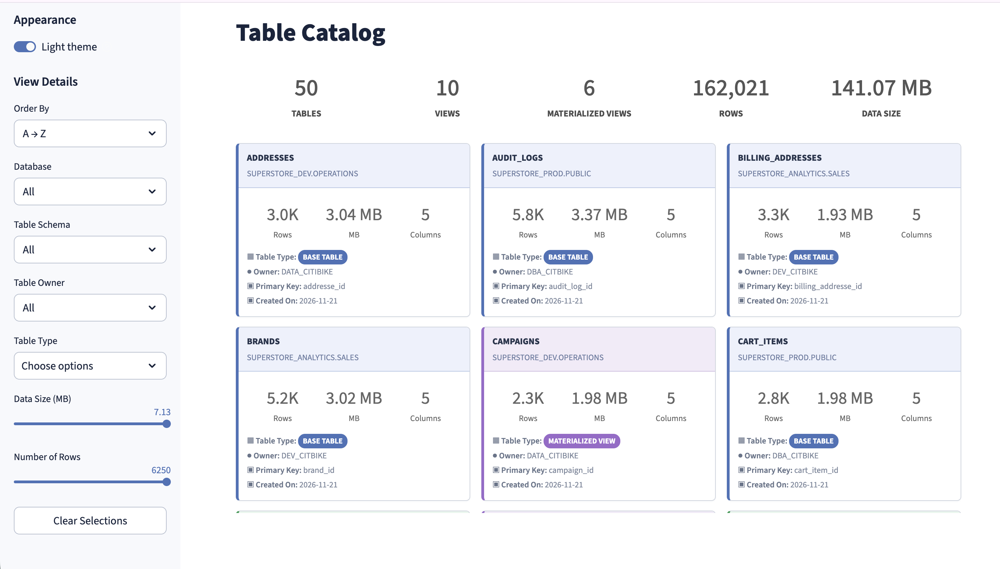
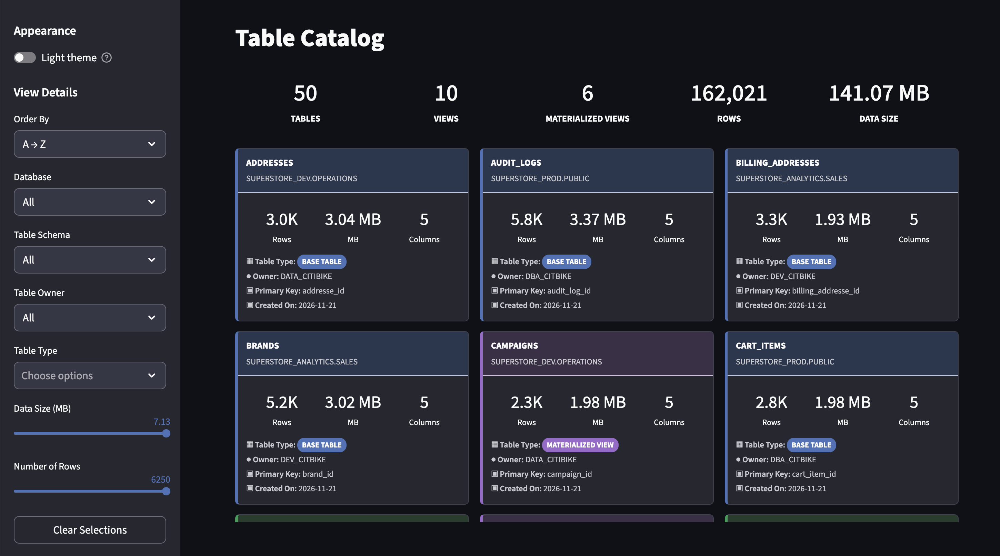

# Unity Catalog Explorer

A Streamlit app for browsing Unity Catalog metadata in Databricks. Select a
catalog and schema, then inspect metadata and column definitions for every
table or for tables you choose. Queries use the signed-in user's Databricks
identity, so catalog visibility follows that user's Unity Catalog permissions.

The app reads metadata only; it does not display table rows.

## Themes

Use the **Light theme** toggle in the sidebar to switch between light and dark
appearance. The sidebar, selectors, dropdown menus, and app header adapt to the
selected theme.

### Light theme



### Dark theme



## Deploy to Databricks Apps

The app uses the signed-in user's permissions to list and connect to their
available SQL warehouses:

1. Under **Settings → User authorization**, add the `sql` scope and save.
2. Give each app user permission to use the SQL warehouses and discover the
   Unity Catalog metadata they should see.
3. Deploy or redeploy the app.

The app uses the `X-Forwarded-Access-Token` supplied by Databricks Apps for each
request. It does not fall back to the app service principal for catalog queries.
The user selects a warehouse from the warehouses visible to their account. If
the selected warehouse is stopped, the app requests that Databricks start it
and waits for it to be ready before querying. Starting a warehouse may incur
compute costs. Local runs do not receive the forwarded token and cannot list
warehouses or browse catalogs.

## Metadata displayed

For visible tables and views, the app displays the table type, owner, comment,
creation and last-altered timestamps, and column names, data types, nullability,
and comments. It queries Unity Catalog `information_schema` metadata and uses
parameterized filters for schema and table names.

## Dependencies

Install dependencies from the project directory with:

```sh
python -m pip install -r requirements.txt
```

## Project layout

- `app.py` - Streamlit interface and theme selection
- `src/databricks_catalog.py` - User-token SQL connection and metadata queries
- `assets/css/` - Light and dark theme stylesheets
- `images/` - Screenshots of the light and dark themes
- `tests/` - Unit tests
- `app.yaml` - Databricks Apps run command

Run the unit tests from the project directory with:

```sh
python -m unittest discover -s tests -p "test_*.py" -v
```
